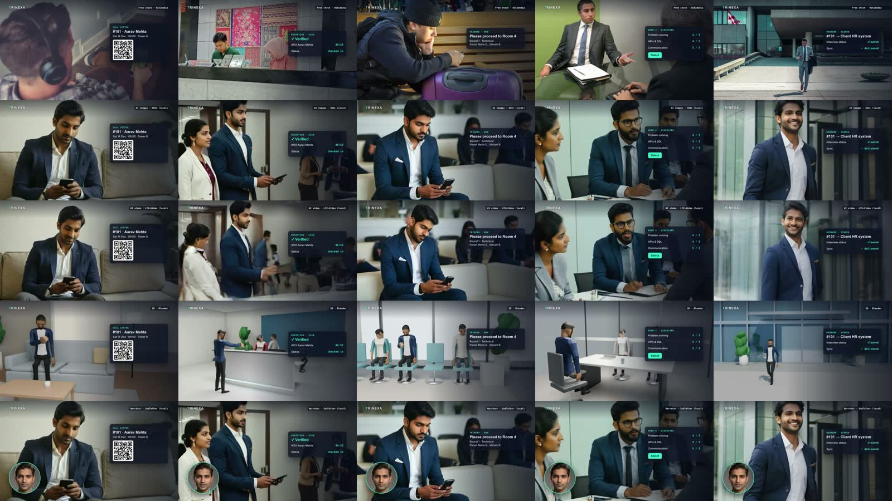

# Character Lab POC: 5 free ways to put people in a product video

One 30-second story, *Aarav's walk-in interview day with Trinexa*, made five ways, all **free and local on a MacBook Pro (M1 Max, 64 GB)**. The voice, script and app overlays are the same in every version; only the people change.



| # | Approach | Result | Verdict |
|---|---|---|---|
| 1 | Free stock photos (Wikimedia / Openverse) | [`results/stock.mp4`](results/stock.mp4) | Real, but a different person in every shot and no usable free video |
| 2 | AI images: SDXL (RealVisXL V4) | [`results/aistill.mp4`](results/aistill.mp4) | ⭐ Best value: realistic and consistent, ~2 min per shot |
| 3 | AI video: LTX-Video 0.9.5 image-to-video | [`results/aivideo.mp4`](results/aivideo.mp4) | People really move; slow (11–26 min per clip) and breaks on crowds |
| 4 | 3D: Blender 4.5 + CC0 rigged characters | [`results/blender.mp4`](results/blender.mp4) | Fully controllable and consistent, but game-style |
| 5 | Talking narrator: SadTalker lip-sync | [`results/narrator.mp4`](results/narrator.mp4) | Good presenter bubble; head movement only |

📄 **Full measured report, with timings, GPU vs CPU, bottlenecks and scores: [REPORT.md](REPORT.md)**

## See them side by side

```bash
python3 -m http.server 8777 --bind 127.0.0.1
# open http://127.0.0.1:8777
```

The dashboard shows the storyboard, every shot per approach, five synced players and each approach's tools, licence and weaknesses.

## What's in here

```
storyline.json          the storyboard: cast, 5 shots, narration, the 5 tracks
spine/                  shared timing and narration (Kokoro TTS, am_michael)
tracks/<approach>/      inputs and outputs per approach, plus status.json (tools, time, weaknesses)
  stock/                5 CC photos + CREDITS.md
  aistill/              chosen stills + all candidates + generation logs
  aivideo/             raw LTX clips, cleaned clips, smoke test, logs
  blender/              rendered shots, CC0 character assets, src/ (Blender Python), CREDITS.md
  narrator/             presenter face + lip-synced narrator.mp4
results/                the five finished 30.4 s videos + per-shot thumbnails
build.py                assembles one approach: shared template + that approach's people → HyperFrames render
gen_stills.py           approach 2 (SDXL on the Apple GPU)
gen_video.py            approach 3 (LTX-Video image-to-video on the Apple GPU)
run-narrator.sh         approach 5 (SadTalker)
download-models.sh      fetches all Hugging Face models in parallel
patches/                SadTalker patch for Apple GPUs (MPS)
logs/timings.json       every measured number in the report
docs/                   comparison images used in the report
index.html              the local dashboard
```

## Reproduce

Requirements: macOS on Apple Silicon, Python 3.10 and 3.11, [uv](https://github.com/astral-sh/uv), ffmpeg, Node (for `npx hyperframes`), and Blender 4.5 for approach 4.

```bash
# AI images + AI video environment
uv venv .venv-ai --python 3.11 && uv pip install --python .venv-ai/bin/python -r requirements-ai.txt
.venv-ai/bin/python gen_stills.py --seeds 2            # writes tracks/aistill/candidates/
.venv-ai/bin/python gen_video.py --frames 121 --steps 30  # writes tracks/aivideo/

# Talking narrator
git clone https://github.com/OpenTalker/SadTalker && (cd SadTalker && git apply ../patches/sadtalker-apple-gpu.patch)
uv venv .venv-talk --python 3.10 && uv pip install --python .venv-talk/bin/python -r requirements-sadtalker.txt
# then download SadTalker's checkpoints (see its scripts/download_models.sh) and run ./run-narrator.sh

# Blender
tracks/blender/src/render_all.sh s1 s2 s3 s4 s5

# Assemble any approach into a 30.4 s video
python3 build.py aistill --render                       # → results/aistill.mp4
```

Run `./download-models.sh` first (or the models download on first run): about 28 GB in total. See REPORT.md §6.

Background music and sound-effect files aren't included because their licences don't allow redistributing the raw files. `build.py` skips them when they're missing.

## Licences

All AI faces are fictional. Licences by component:
- **Stock photos:** CC0 / CC BY / CC BY-SA, see `tracks/stock/CREDITS.md`.
- **Blender characters:** Quaternius, CC0.
- **Models:**
  - RealVisXL: CreativeML Open RAIL++-M.
  - LTX-Video 0.9.5: Open RAIL-M.
  - SadTalker and GFPGAN: Apache-2.0.
  - Kokoro TTS: Apache-2.0.

The rendered MP4s include the background music bed "Happy Beats / Business Moves" by ende.app.
